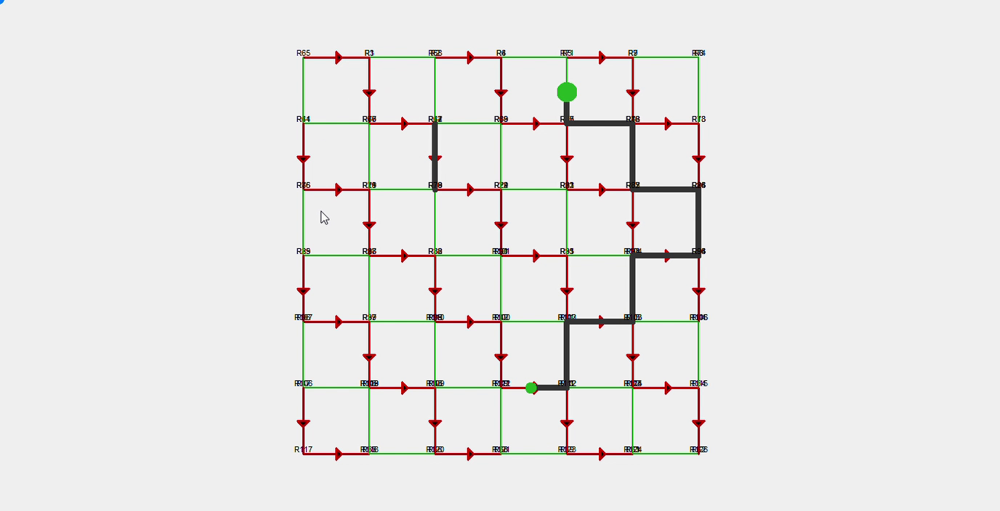
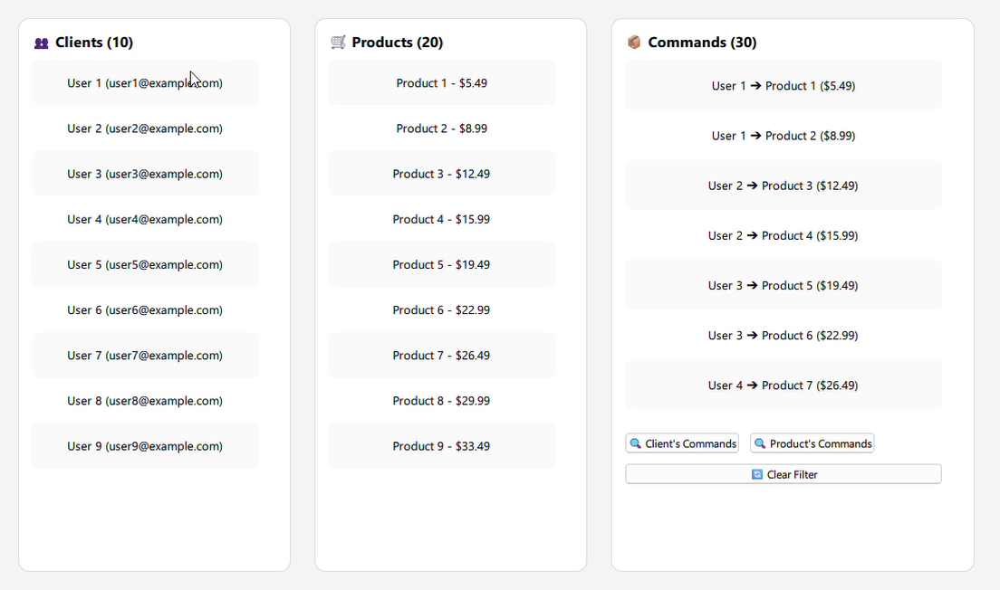

# TModeler C++

TModeler is a **data engine-oriented framework** for building data-centric applications. It provides a unified development foundation to model, store, observe, synchronize, and process business data in **C++** applications, with support for **desktop**, **client/server**, **Qt/QML**, and **geospatial** use cases.

This repository contains the **official C++ distribution** of the project: data engine, ORM, observation system, filters, joins, aggregations, geospatial support, and UI adapters.

## Framework Vision

TModeler automates three key application development areas:

1. **Data modeling and management** with its `TModel` ORM.
2. **Security** with the `THC` cryptographic toolkit for end-to-end encryption.
3. **Client/server auto-sync** with `TSM`, to synchronize business state across modules and services.

In practice, this helps teams build business-oriented applications faster by relying on a structured, reusable data core.

> This repository mainly focuses on the **C++ layer of the framework**, especially the data engine and the `TModel` ORM.

---

## Framework Building Blocks

### `TModel` - ORM and modeling engine

`TModel` allows you to define typed C++ models and manage persistence, relations, filters, joins, observers, and CRUD operations.

### `THC` - Security and end-to-end encryption

`THC` is the security block of the TModeler ecosystem, designed to protect data and application exchanges with an end-to-end encryption approach.

### `TSM` - Client/server auto-sync

`TSM` complements the framework with automatic synchronization logic between clients, services, and modules to ensure data consistency in distributed architectures.

---

## Main Capabilities of the C++ Version

- Typed model definition through `TModel<T>` and `TM_SCHEMA(...)`
- Full CRUD and centralized management through `Tms<T>`
- Composed filters, joins, grouping, and aggregations
- Inter-thread and inter-module observers
- JSON fields, lists, relations, and model inheritance
- Geospatial support with `GeoField`
- MVVM integration with Qt/QML adapters

---

## Visual Demos

### Geospatial Demo

This demo illustrates how TModeler handles complex road networks, multiple intersections, traffic constraints, and advanced routing scenarios.



### UI MVVM Demo (Qt/QML)

This demo shows how TModeler can be used with an **MVVM** architecture in **Qt/QML** to build responsive interfaces connected to the data engine.



---

## Repository Content

- `include/`: framework headers (`core`, `db`, `field`, `model`, `modeler`, `ms`)
- `src/`: C++ engine implementations
- `adapters/`: Qt/QML and Web adapters
- `assets/`: internal visuals and demos
- `tests/`: unit tests and usage scenarios

---

## Prerequisites

- CMake 3.24 or newer
- C++17 or newer
- Git
- SpatiaLite (optional, for geospatial features)

## Installation and CMake Integration

The official project repository is now:

- `https://github.com/eclipse-tmodeler/tmodeler-cpp`

Example integration with `FetchContent`:

```cmake
include(FetchContent)

FetchContent_Declare(
    TModeler
    GIT_REPOSITORY https://github.com/eclipse-tmodeler/tmodeler-cpp.git
    GIT_TAG main
)

FetchContent_MakeAvailable(TModeler)

target_link_libraries(${PROJECT_NAME}
    PRIVATE TModeler
)
```

### Geospatial Dependencies

- **Windows**: copy the required TModeler binaries next to your executable.
- **Linux**: install SpatiaLite with:

```bash
sudo apt update
sudo apt install spatialite-bin libsqlite3-mod-spatialite
```

---

## Quick Start

Before using models, initialize TModeler and the required databases.

```cpp
TModeler::start()
    .dbReady([]()
    {
        // Data management starts here
    })
    .init(Tdb::Builder()
        .type(Tdb::Type::SQLITE)
        .dbDir("/tmp/sql")
        .dbName("test.db")
        .accept("models.shops")
        .accept("models.users")
        .get())
    .init(Tdb::Builder()
        .type(Tdb::Type::SQLITE)
        .host("localhost")
        .dbName("test2.db")
        .get());
```

> This initialization is required before using any TModeler models, including in tests.

---

## Modeling with `TModel`

All models inherit from `TModel<T>` and declare their schema with `TM_SCHEMA(...)`.

### Simple Model Example

```cpp
class Client : public TModel<Client> {
    TM_SCHEMA(Client, "models.shops", TF(name), TF(age), TF(height), TF(dob), TF(friends))

    TextField name;
    IntField age;
    FloatField height;
    TimeField dob = init<TimeField>().format(TF::DATE);
    ListField<Client> friends;
};

// In a .cpp file to expose the static manager Client::tms
TM_MANAGER(Client)
```

### Model Relationships

```cpp
class Product : public TModel<Product> {
    TM_SCHEMA(Product, "models.shops", TF(name))

    TextField name;
};
TM_MANAGER(Product)

class Cmd : public TModel<Cmd> {
    TM_SCHEMA(Cmd, "models.shops", TF(client), TF(product))

    ModelField<Client> client;
    ModelField<Product> product;
};
TM_MANAGER(Cmd)
```

### Advanced Example

```cpp
class Familly : public TModel<Familly> {
    TM_SCHEMA(Familly, "models.group", TF(name))

    TextField name;
};
TM_MANAGER(Familly)

class Person : public TModel<Person> {
    TM_SCHEMA(Person, "models.users",
        TF(name), TF(design), TF(ratio), TF(empty),
        TF(dob), TF(update_at),
        TF(myFamilly), TF(bigFamilly), TF(friends))

    TextField name;
    TextField design;
    FloatField ratio;
    BoolField empty;
    TimeField dob = init<TimeField>().format(TF::DATE);
    TimeField update_at = init<TimeField>().format(TF::DATE_TIME);
    ModelField<Person> myFamilly = init<ModelField<Person>>().onDelete(TF::CASCADE);
    ModelField<Familly> bigFamilly = init<ModelField<Familly>>().onDelete(TF::CASCADE);
    ListField<Person> friends = init<ListField<Person>>();
    GeoField location = GeoField().spatialIndex(true);
};
TM_MANAGER(Person)
```

---

## CRUD and Data Management

Each model exposes a static `Tms<T>` manager through `Model::tms`.

```cpp
Client cl1, cl2, cl3;
Product pr1, pr2;
Cmd cm1, cm2;

Client::tms.clear();
Product::tms.clear();
Cmd::tms.clear();

if (Client::tms.all().empty()) {
    cl1.name = "Lambda";
    cl1.age = 15;
    cl1.height = 1.70;
    cl1.dob = "2010-01-01";
    cl1.save();

    cl2.name = "Sigma";
    cl2.save();

    cl3.name = "Omega";
    cl3.save();

    cl1.friends = { &cl2, &cl3 };
    cl1.save();
}

if (Product::tms.all().empty()) {
    pr1.name = "Chicken";
    pr2.name = "Fish";
    pr1.save();
    pr2.save();
}

if (Cmd::tms.all().empty()) {
    cm1.client = cl1;
    cm1.product = pr1;
    cm1.save();

    cm2.client = cl1;
    cm2.product = pr2;
    cm2.save();
}

Log::d("Client:\n" + Client::tms.all().data());
Log::d("Product:\n" + Product::tms.all().data());
Log::d("Cmd:\n" + Cmd::tms.all().data());
```

---

## Filters, Joins, and Aggregations

The engine provides an expressive DSL to build composed queries.

```cpp
namespace Expr {
    inline Person p{};
    inline Client cl{};
    inline Cmd cm{};
}

using Expr::cl;
using Expr::cm;
using Expr::p;

auto filter = Person::tms.with(p).filter(
    (p.dob >= "2000-11-04") &&
    (p.name != "Lambda") &&
    (p._id >>= {186, 187})
);

auto grouped = Client::tms.with(cl)
    .filter(cl._id > 0)
    .order(+cl.name)
    .group(cl.name)
    .filter(cl._id.count() == 2);

Tlist<Client, Cmd> join = Client::tms.with<Cmd>(cl, cm)
    .join(JoinType::LEFT)
    .filter(cm.client == cl)
    .filter(cm.client == nullptr)
    .order(-cl.dob)
    .group(cl._id)
    .filter(cl._id.count() <= 2);
```

### Available Operators

| Operator | Meaning |
|---|---|
| `==`, `!=`, `>`, `<`, `>=`, `<=` | Standard comparisons |
| `&&`, `||`, `!` | Logical combinations |
| `%` | `LIKE`-style search |
| `>>=` | Membership test (`IN`) |
| `== nullptr` | Null value test |
| `.count()` | Count aggregate |

---

## Observers and CRUD Events

TModeler allows observing data changes to react in real time from interfaces, services, or application workflows.

```cpp
Tms<Client> tms;

tms.onSave([](auto keys) {
    Log::d("onSave...\n" + Client::tms.get(keys).data());
});

tms.onCreate([](auto keys) {
    Log::d("onCreate...\n" + Client::tms.get(keys).data());
});

tms.onUpdate([](auto keys) {
    Log::d("onUpdate...\n" + Client::tms.get(keys).data());
});

tms.onDelete([](auto keys) {
    Log::d("onDelete...\n" + vectorToString(keys));
});

tms.onModelChange([](auto keys) {
    Log::d("onModelChange...\n" + vectorToString(keys));
});
```

---

## Geospatial Data

Geospatial support is based on `GeoField`, with spatial indexing, intersection filters, distance, azimuth, and other dedicated operations.

```cpp
auto filter = Geo::tms.with(g0)
    .lazy()
    .filter(g0.loc.index(p1) && g0.loc.intersects(p1))
    .group(g0.title)
    .filter(g0._id.count() >= 2)
    .build();

Log::d(filter.data());
```

---

## UI Integration with Qt/QML

Qt adapters allow connecting a `TViewModel` to a QML interface using an MVVM architecture.

```cpp
class Client : public TModel<Client> {
    TM_SCHEMA(Client, "models.shops", TF(name), TF(email), TF(friends))

    TextField name;
    TextField email;
    ListField<Client> friends;
};

class ClientItem : public TItem<Client> {
    Q_OBJECT
    TM_QML_ITEM
};

class ClientViewModel : public TViewModel<Client> {
    Q_OBJECT
    TM_QML_VM(Client, ClientItem)
};
```

```qml
property var item: clientModel.get(index)

Row {
    spacing: 10
    anchors.verticalCenter: parent.verticalCenter

    Text {
        text: item.data.name + " (" + item.data.email + ")"
        font.bold: index === listView.currentIndex
    }
}

Button {
    text: "Update"
    enabled: selectedIndex >= 0
    onClicked: {
        let item = clientModel.get(selectedIndex)
        let current = item.data
        current.name = nameInput.text
        current.email = emailInput.text
        item.data = current
        nameInput.text = ""
        emailInput.text = ""
        selectedIndex = -1
    }
}
```

---

## Tests and Examples

To explore concrete scenarios, see in particular:

- `tests/TestsTM.cpp`
- `tests/modelsTM.cpp`
- `tests/ViewerApp.cpp`

---

## Project Status

This project is actively maintained as part of the Eclipse TModeler initiative.
The C++ module represents the core data engine of the ecosystem.

---

## Unified DSL Contract

`TModeler` is the framework and the developer-facing DSL.

- Application developers build on `TModeler` calls.
- Developers do not need to call `TSM` or `THC` directly in business code.
- `TModel`, `TSM`, and `THC` are core organs of the same environment and execute behind the `TModeler` DSL.

In short: developers focus on business features, while TModeler orchestrates modeling, synchronization, and security.

### Runtime Model

```text
App code
  -> TModeler DSL
     -> Core organs (TModel | TSM | THC)
        -> Local/remote execution services
```

---

## Core, Interfaces, and Advanced Extensions

TModeler follows a practical strategy:

- A functional core that works without mandatory external dependencies.
- Open interfaces for synchronization and cryptography integration.
- Optional advanced derivatives for high-end scenarios.

| Layer | Scope | Status |
|---|---|---|
| `TModel` | Fully defined ORM/modeling layer | Available in current C++ module |
| `TSM` and `THC` (core interfaces) | Internal sync/security organs exposed through TModeler | Included in TModeler architecture |
| `TSM+` and `THC+` | Advanced AI-assisted sync/security capabilities | Optional extensions (outside base OSS runtime) |

This keeps the public framework robust and usable out of the box, while leaving room for advanced enterprise-grade capabilities.

---

## Advanced DSL Vision (Roadmap Preview)

The following examples illustrate the product direction for advanced sync and security operations.

> **Important:** these DSL snippets are currently aligned with KMP-oriented design explorations and roadmap scope. The C++ module does not yet expose the full advanced API shown below.

### Complex Client/Server Auto-Sync Query

```kotlin
fun loadPrivateOnline(channel: Channel, messagers: List<Messager>, result: (Boolean?, Messaging?) -> Unit) {
    if (messagers.size < 2) {
        result(null, null)
        return
    }

    val m1 = messagers[0]
    val m2 = messagers[1]
    val ch1 = channel

    val m = Messaging.tms.lambda
    val mm = MessagingMember.tms.lambda
    val cm = ChannelMessaging.tms.lambda

    MessagingMember.tms.with(mm, m, cm)
        .lazy()
        .merge(mm.messaging + m)
        .merge(m + cm.messaging)
        .filter(m.mType eq MessagingType.PRIVATE)
        .filter(mm.messager into listOf(m2))
        .filter(cm.channel eq ch1)
        .pullAsFlow {
            // stream synced result
        }
}
```

This is the type of complex query TModeler aims to keep simple for app developers, while advanced bridge execution can be handled by `TSM+` where needed.

### Secure DSL Examples

```kotlin
// Encrypt and send privately
content.secure(text)
    .from(alice)
    .to(bob)

// Decrypt as receiver
val clearText = content.unlock()
    .as(bob)
    .verify()
    .read()

// Sign and verify
content.sign(text)
    .by(alice)
    .timestamp()

val isAuth = content.verify()
    .from(alice)
    .signature(msg.signature)
    .check()
```

The objective remains consistent: provide end-to-end security to product teams without requiring deep cryptography expertise in day-to-day business development.

---

## Contributing

See `CONTRIBUTING.md` for development guidelines, build instructions, and contribution workflow, and `CODE_OF_CONDUCT.md` for community rules. To report a vulnerability, see `SECURITY.md`.

## Contact

TAMBO ai — [tamboai.co](https://tamboai.co) — [contact@tamboai.co](mailto:contact@tamboai.co)

---
